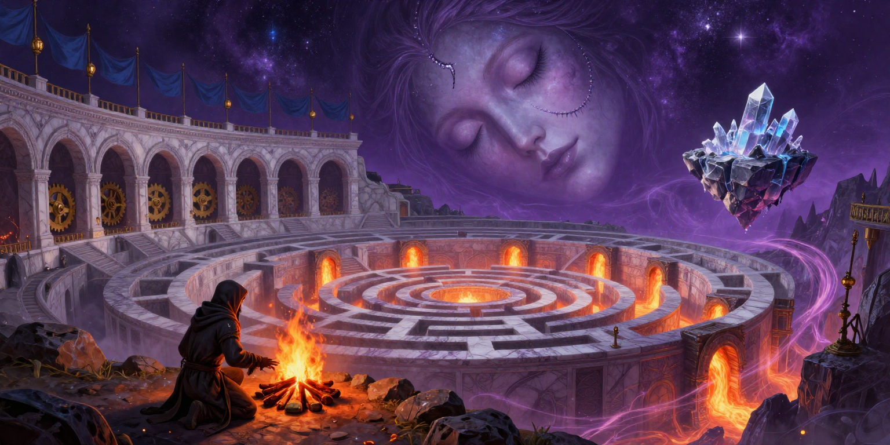

<a id="top"></a>

<div align="center">



# 🌀 Il Labirinto degli Elementi e del Caos

### Scendi. Muori. Ricorda. Scendi ancora.

**Un gioco di ruolo roguelite da terminale, in italiano, gratuito e open source.**<br>
Ogni discesa è diversa, ogni morte ti rende più forte e un mondo intero aspetta di essere ricordato.

<br>

[](https://github.com/fedeveloper/rogue/actions/workflows/tests.yml)
[](LICENSE)


<br>

**[⬇️ Installazione](#installazione)** · **[🎮 Come si gioca](#come-si-gioca)** · **[🌍 Il mondo](#il-mondo)** · **[✨ Caratteristiche](#caratteristiche)** · **[❓ Domande](#domande)** · **[📜 Licenza](#licenza)**

</div>

---

## 🌀 Che cos'è

*Il Labirinto degli Elementi e del Caos* è un **gioco di ruolo a turni** che si gioca nella finestra del terminale, con la tastiera. Non serve una scheda grafica, non serve un account, non si compra niente: scarichi una cartella, scrivi un comando e sei dentro.

Interpreti **il Ritornante**, qualcuno che si sveglia accanto a un fuoco che non brucia senza ricordare il proprio nome. Sotto di te si apre un Labirinto che ha inghiottito un intero mondo, Aethelgard: **30 piani**, **6 biomi**, mostri, trappole, mercanti ed eventi che ti chiedono di scegliere. In fondo dorme il **DIO ANTICO**.

È un **roguelite**: ogni discesa è generata da capo e, quando muori, ricominci dall'inizio. Ma non a mani vuote. L'**Essenza** che riporti al Campo sblocca nuovi eroi, armi, reliquie e potenziamenti, e chi hai incontrato laggiù viene a sedersi al tuo fuoco per raccontarti chi era. Ogni discesa ti porta un po' più a fondo, nel Labirinto e nella sua storia.

<table>
<tr>
<td width="33%" valign="top">

### 🎲 Mai uguale
Mappa, nemici, bottino ed eventi cambiano a ogni discesa. 9 eroi, 10 tratti e 20 gradi di Ascensione fanno **3.780 partenze diverse**.

</td>
<td width="33%" valign="top">

### 💀 La morte insegna
Morire fa parte del gioco. L'Essenza che riporti al Campo diventa **potenziamenti permanenti**, e chi ti ha ucciso torna a cercarti come **Nemesi**.

</td>
<td width="33%" valign="top">

### 📖 Un mondo da leggere
**Oltre 119.000 parole** di storia: 205 conversazioni al Campo, 70 libri da sbloccare, 168 eventi a scene e 5 finali.

</td>
</tr>
</table>

## 👀 Uno sguardo

Il gioco è fatto di testo, colori e disegni in caratteri. Questo è l'arrivo davanti al primo boss, così come appare nel terminale:

```text
╔═ LA VOCE CHE CONSOLA ══╗
║      .-^^^-.           ║
║     /  _ _  \          ║
║    |  (-) (-)|         ║
║    |    |    |         ║
║     \  ._.  /   ssh... ║
║   .-'`-...-'`-.        ║
║  /   /  |  \   \       ║
║ /___/   +   \___\      ║
╚════════════════════════╝
"Guidava le preghiere dell'accademia. Ora prega perché tu resti per sempre."
```

E questo è un turno di combattimento: il nemico **annuncia la sua prossima mossa**, e tu scegli se attaccare, difenderti, lanciare un incantesimo o fuggire.

```text
      _____
     ( o o )__
     |  ^  |  \
    /|_____|\  O
   / |     | \
     |_| |_|

--- ⚔️ IN COMBATTIMENTO ⚔️ ---
Tu      ████████████░░░░ 96/120 HP
Goblin  ████████░░░░░░░░ 8/16 HP
Intento del nemico: 💢 Colpo pesante — difenditi!

  > Attacca
    Difesa Aggressiva (Dimezza danni e Contrattacca)
    Apri Inventario (Usa oggetto = Costa Turno)
    Statistiche Eroe
    Tenta la Fuga
```

Ogni bioma ha il suo paesaggio, le sue regole e i suoi abitanti:

```text
╔════ 🦇  LE MINIERE DELLA TESTARDAGGINE ════╗
║ /\/\/\/\/\/\/\/\/\/\/\/\/\/\/\/\/\/\/\/\/\ ║
║ |==|      o       |==|       o      |==|   ║
║ |  |   .-'|'-.    |  |    .-'|'-.   |  |   ║
║ |__|_=_=_=_=_=_=_=|__|=_=_=_=_=_=_=_|__|   ║
╚════════════════════════════════════════════╝
Pericolo: Gas del Silenzio. In ogni scontro c'è il 35% di probabilità che il gas riempia la stanza: la tua Difesa dimezza ancora i danni, ma perde la tecnica della tua classe, e non riesci a lanciare incantesimi.
```

<a id="installazione"></a>

## ⬇️ Installazione

Il gioco funziona su **Windows, macOS e Linux** e ha bisogno di una cosa sola: **Python 3.9 o più recente**. Non c'è niente altro da installare.

### 1. Installa Python

<details>
<summary><b>🪟 Windows</b></summary>

1. Vai su [python.org/downloads](https://www.python.org/downloads/) e scarica l'ultima versione (oppure installa *Python* dal **Microsoft Store**).
2. Avvia l'installer e **spunta la casella «Add python.exe to PATH»** prima di premere *Install Now*.
3. Per controllare: apri il menu Start, cerca **Terminale** (o *Prompt dei comandi*) e scrivi `py --version`. Deve comparire `Python 3.` seguito da un numero.

</details>

<details>
<summary><b>🍎 macOS</b></summary>

1. Vai su [python.org/downloads](https://www.python.org/downloads/) e scarica l'installer per macOS (oppure, se usi Homebrew, `brew install python`).
2. Apri l'app **Terminale** (la trovi con Spotlight, ⌘ + Spazio) e scrivi `python3 --version` per controllare.

</details>

<details>
<summary><b>🐧 Linux</b></summary>

Quasi tutte le distribuzioni hanno già Python 3. Controlla con `python3 --version`; se manca, installalo dal gestore di pacchetti (per esempio `sudo apt install python3` su Debian e Ubuntu).

</details>

### 2. Scarica il gioco

**Senza Git (più semplice):** premi il pulsante verde **Code** in alto in questa pagina e scegli **Download ZIP**, oppure [scarica lo ZIP direttamente](https://github.com/fedeveloper/rogue/archive/refs/heads/main.zip). Poi estrai la cartella dove preferisci.

**Con Git:**

```bash
git clone https://github.com/fedeveloper/rogue.git
```

### 3. Avvia

Apri il terminale **nella cartella del gioco** e lancia `roguelike.py`:

| Sistema | Comando |
|---|---|
| 🪟 Windows | `py roguelike.py` |
| 🍎 macOS | `python3 roguelike.py` |
| 🐧 Linux | `python3 roguelike.py` |

> 💡 **Come si apre il terminale nella cartella giusta.** Su Windows: apri la cartella in Esplora file, clicca col tasto destro su uno spazio vuoto e scegli *Apri nel Terminale*. Su macOS: trascina la cartella sull'icona di Terminale, oppure scrivi `cd ` e trascina la cartella nella finestra. Su Linux: tasto destro → *Apri in un terminale*.

### Per giocare al meglio

- **Una finestra ampia.** Allarga il terminale ad almeno **100 colonne e 30 righe**: la mappa del piano usa lo spazio in più per disegnare i collegamenti fra le stanze.
- **Un terminale moderno.** Su Windows usa **Windows Terminal** (è già installato su Windows 11): colori ed emoji si vedono bene. Se nel vecchio *Prompt dei comandi* le emoji appaiono come quadratini, scrivi prima `chcp 65001`.
- **Aggiornare.** Con Git: `git pull` nella cartella del gioco. Con lo ZIP: scarica la versione nuova e copiaci dentro il tuo `profile.json`, così i progressi restano.
- **Disinstallare.** Basta cancellare la cartella: il gioco non scrive niente altrove.

<a id="come-si-gioca"></a>

## 🎮 Come si gioca

### I comandi

Si gioca **solo con la tastiera**:

| Tasto | Cosa fa |
|---|---|
| ⬆️ ⬇️ | Scorri le voci dei menu |
| **Invio** | Conferma la scelta, prosegui nel racconto |
| **«Indietro»** | Non è un tasto ma l'ultima voce di molti menu: riporta alla schermata precedente |
| **Ctrl + C** | Esci dal gioco in qualunque momento |

### La prima discesa

1. **Scegli un eroe.** All'inizio puoi essere **Guerriero**, **Ladro** o **Mago**; gli altri si sbloccano giocando. Per cominciare, il Guerriero è robusto e semplice da usare.
2. **Scegli il percorso.** Ogni piano è una mappa di stanze collegate: combattimenti, mercanti, falò, forzieri, trappole ed eventi. Vedi tutto fin dall'arrivo: decidi tu quanto rischiare.
3. **Combatti leggendo il nemico.** Prima di ogni tuo turno il nemico dice cosa sta per fare. Se prepara un colpo pesante, difenditi; se si chiude in guardia, è il momento di caricare.
4. **Cresci.** A ogni livello metti un punto in un attributo; ogni cinque livelli scegli un talento. Equipaggia le armi che trovi e incastona le rune al falò.
5. **Affronta il boss** in fondo al piano e scendi. Ogni cinque piani cambia il bioma, con nuove regole e nuovi nemici.
6. **Quando cadi**, torni al **Campo Base** con l'Essenza raccolta: spendila nei potenziamenti, parla con chi siede al fuoco, leggi ciò che hai scoperto nel **Codice** e nell'**Archivio**. Poi riparti.

> 💾 **Il salvataggio è automatico.** I progressi stanno in `profile.json`, che si crea da solo al primo avvio. A metà discesa puoi scegliere **Salva ed esci** e riprendere più tardi dallo stesso punto.

Le regole complete, con strategie e consigli, sono nel [**📖 Manuale del Giocatore**](MANUALE_GIOCATORE.md).

<a id="il-mondo"></a>

## 🌍 Il mondo di Aethelgard

Mille anni fa, in una notte sola, il cielo si strappò. Gli elementi che gli Architetti avevano tenuto insieme si separarono, le città sprofondarono e il mondo intero scese in un Labirinto che da allora non smette di cambiare forma. Tu sei l'unico che, morendo laggiù, torna indietro. Nessuno sa perché. Forse nemmeno il Fuoco che ti riporta.

Il Labirinto è fatto di quello che c'era prima: l'Accademia di Aurelia è diventata un chiostro di silenzio, le miniere dei nani scavano ancora verso il basso, il Mare Interno è un ventre che digerisce i ricordi.

|  | Bioma | Piani | Il pericolo |
|---|---|---|---|
| 📿 | **I Chiostri del Rimpianto** | 1-5 | *Nostalgia Letale* |
| 🦇 | **Le Miniere della Testardaggine** | 6-10 | *Gas del Silenzio* |
| 🌀 | **Le Guglie del Vento Urlante** | 11-15 | *Caduta Astrale* |
| 🌊 | **Il Ventre della Memoria** | 16-20 | *Dissoluzione dell'Io* |
| 🌋 | **La Forgia del Caos** | 21-25 | *Ebollizione Astrale* |
| 🌌 | **La Soglia del Dio Antico** | 26-30 | *Paradosso Temporale* |

Chi incontri nel Labirinto ha una storia, e se lo salvi viene a raccontartela al Campo: un astronomo che cerca la sorella, una cartografa che finisce la mappa del nonno, un vecchio speziale che non si perdona, un paladino che custodisce da mille anni una porta che non porta più da nessuna parte. **Più scendi, più ricordi.** Il resto lo scopri giocando.

<a id="caratteristiche"></a>

## ✨ Caratteristiche


- 🗺️ **Una mappa per ogni piano.** Quattro file di stanze collegate (combattimento, Élite, mercante, falò, forziere, trappola, evento o la *Stanza del Mistero*) e il boss in fondo, tutte visibili fin dall'arrivo: scegli il percorso, non solo la porta. Ogni stanza ha un prezzo e un premio: le trappole custodiscono un bottino, i forzieri profondi possono essere Mimic, e l'**Audacia** fa crescere il bottino del boss per ogni rischio corso nel piano. Nemici e boss crescono con la profondità, e quasi ogni nemico ha uno **stile** (Bruto, Predatore, Difensore, Succhiavita, Infetto, Mistico, Furia) che decide le mosse che preferisce.
- 🌍 **Sei biomi, sei regole.** Ogni cinque piani il Labirinto cambia volto e legge: la *Nostalgia Letale* dei Chiostri, il *Gas del Silenzio* delle Miniere, la *Caduta Astrale* delle Guglie, la *Dissoluzione dell'Io* del Ventre, l'*Ebollizione Astrale* della Forgia e il *Paradosso Temporale* della Soglia. Ogni bioma ha sei nemici nativi, un boss tutto suo e le sue stanze speciali.
- 🔥 **Combattimento tattico.** Il nemico **annuncia la sua mossa**, colpo pesante, guardia, rigenerazione o colpo infetto, e tu decidi se attaccare o difenderti. Sette elementi, vantaggi e svantaggi, **Risonanze** quando arma e armatura condividono l'elemento e **7 reazioni** (Vapore, Gelo, Eclissi…) quando li combini.
- 🧬 **9 classi** con alberi di Maestria a 5 livelli che sbloccano bonus, oggetti, reliquie e altre classi.
- 🔮 **La magia.** 18 incantesimi che costano **Etere**, una risorsa che resta fra uno scontro e l'altro e si guadagna colpendo, difendendosi e scatenando reazioni. Lasciano il marchio del loro elemento: con l'arma di Fuoco e *Lama d'Acqua* componi il *Vapore* senza cambiare equipaggiamento.
- 📈 **Sei attributi da costruire.** A ogni livello un punto fra Vitalità, Forza, Destrezza, Agilità, Arcano, Fortuna: ogni discesa è una build diversa, e il raro *Tomo dell'Oblio* permette di ripensarla al Falò.
- 🌟 **Talenti.** Ogni 5 livelli scegli uno dei 15 talenti fra 3 proposti a caso: danni, difesa, Etere, cure, fortuna.
- 🎭 **10 tratti** e **20 gradi di Ascensione**: 3.780 combinazioni di partenza diverse.
- 📅 **Sfida del Giorno.** Una discesa al giorno uguale per tutti: eroe, tratto, malus e dono assegnati, la stessa mappa a ogni piano. Conta il primo tentativo; punteggio, serie di giorni e record restano nel profilo.
- 📖 **Eventi che ricordano.** 168 storie a scene con opzioni che esistono solo per la tua classe, il tuo tratto o le tue reliquie: `[Mago]`, `[Tocco di Mida]`, `[Chiave Arrugginita]`. Il Labirinto ricorda chi hai aiutato e chi hai derubato, e certe scelte tornano a bussare qualche piano dopo.
- 🗝️ **Personaggi che ritornano.** *Sir Alaric*, il Primo Paladino, *Silas*, il Cercatore, la Fata della Fontana, il fabbro muto e il Mercante Senza Volto hanno storie in più capitoli che proseguono di run in run. Le tue scelte decidono come finiscono, e se liberi Alaric il Cavaliere Oscuro non tornerà più.
- 🔷 **Rune e Incastoni.** 20 rune da incastonare al Falò in armi e armature: allungano i marchi, potenziano le reazioni, fanno sanguinare, rubano vita, riflettono i colpi. Restano sull'oggetto finché non le estrai, quindi ogni cambio d'arma è una scelta. Le combinazioni giuste formano 11 **parole runiche** da scoprire.
- 👑 **Boss che cambiano.** A metà della vita ogni boss entra in una nuova fase con un nome, mosse nuove e regole proprie: il Re dei Goblin chiama le guardie, il Drago di Zaffiro si copre di Scaglie che solo una reazione elementale infrange, la Badessa ti sigilla la difesa. Il DIO ANTICO ha tre fasi, e nella seconda diventa l'elemento che ti ferisce di più. Ogni bioma ha il suo boss nativo, dalla Badessa dei Chiostri al Custode della Soglia.
- 😈 **La Nemesi.** Il nemico che ti uccide se ne ricorda: prende un nome, un rango e il tuo Oro, impara qualcosa da te e torna a cercarti vicino al piano della tua morte. Sconfiggilo e ti riprendi tutto, con un trofeo.
- 🪦 **Un epitaffio per ogni discesa.** A fine partita poche frasi raccontano chi eri, cosa hai attraversato e chi ti ha ucciso; il Cimitero del Codice conserva le ultime cinquanta.
- 🩸 **Corruzione.** Le scelte oscure danno potere e opzioni proibite, ma il Labirinto comincia a nasconderti le cose: gli effetti delle scelte, le mosse dei nemici.
- 🏁 **5 finali.** Uccidere il Dio, prenderne il posto, risvegliare Aethelgard… e un finale segreto per chi legge davvero il Labirinto.
- 🔥 **Un campo che ricorda.** Chi salvi nel Labirinto viene a scaldarsi al tuo fuoco, ti parla di ciò che hai fatto e ti aiuta a costruire.
- 📚 **Una storia da leggere con calma.** In discesa il testo è breve; la storia vera si legge fuori: 205 conversazioni al Campo, 70 libri nell'Archivio, l'*Atlante* dei biomi, le *Vite prestate* degli eroi, l'*Armeria* con la storia di ogni oggetto, le lettere delle discese dimenticate. Si sblocca un pezzo alla volta, man mano che scendi.
- 🎨 **Grafica nel terminale.** Ogni boss ha il suo ritratto, ogni nemico la sagoma della sua famiglia, ogni bioma il suo paesaggio; HP ed Etere hanno le loro barre.
- 🌟 **55 reliquie** che piegano le regole: danni raddoppiati, scudi, vampirismo, oro moltiplicato.
- 🏕️ **Meta-progressione profonda**: potenziamenti permanenti, una Forgia per sbloccare equipaggiamento, artigiani da liberare, un Archivio di lore con bonus, imprese da completare.
- ♾️ **Modalità Infinita** dopo la prima vittoria: oltre il piano 30 inizia il **Ciclo del Labirinto**. I sei biomi tornano in un ordine nuovo a ogni ciclo, ogni ciclo è un'Eco più dura (Eco II, Eco III…) e alla fine di ognuno ti attende di nuovo il DIO ANTICO.

## 🧭 Dentro il gioco

Tutto quello che serve sapere prima di scendere: gli eroi, le modalità, le regole del combattimento e cosa succede al Campo fra una discesa e l'altra.

### 🧬 Gli eroi

| Classe | HP | Stile | Maestria Lv.2 | Sblocco |
|---|---|---|---|---|
| ⚔️ **Guerriero** | 140 | Tank bilanciato, contrattacca quando si difende | Mano Pesante | Iniziale |
| 🗡️ **Ladro** | 90 | Agile e ricco, critico garantito dopo la Concentrazione | Tasche Nascoste | Iniziale |
| 🔮 **Mago** | 90 | Arma di Fuoco potente e mira eccellente, ma fragile; si cura difendendosi | Sintonia | Iniziale |
| 🛡️ **Paladino** | 195 | Ultra-tank con Risonanza di Luce; difendendosi si purifica | Baluardo della Fede | Maestria Guerriero Lv.5 |
| 🪓 **Berserker** | 110 | Glass cannon: l'ascia più forte, nessuna armatura | Furia Sanguinaria | Impresa «Danza con la Morte» |
| 🧪 **Alchimista** | 85 | Due pozioni iniziali e bombe di Fuoco; difendendosi prepara le reazioni | Metabolismo Alterato | Impresa «Genio Elementale» |
| 🥷 **Assassino** | 75 | Critico innato e schivata alta, ma fragile | Imboscata | Maestria Ladro Lv.5 |
| 💀 **Negromante** | 75 | Risonanza di Tenebra; difendendosi ruba vita | Raccolto d'Anime | Maestria Mago Lv.5 |
| 🌈 **Elementalista** | 85 | Maestro delle reazioni: Etere abbondante, incantesimi di Vento e Acqua su una verga di Terra | Catena Elementale | Impresa «Alchimia degli Elementi» |

Ogni classe ha un **albero di Maestria** a 5 livelli. Si sale giocando con quella classe. Il **Lv.4** dà un bonus permanente a *tutti* gli eroi; il **Lv.5** sblocca una classe, un tratto o una reliquia. Assassino e Negromante, per esempio, si conquistano portando al massimo Ladro e Mago.

### 🎭 Tratti

All'inizio di ogni discesa scegli un **tratto**, che cambia le regole per tutta la partita:

| Tratto | Effetto | Sblocco |
|---|---|---|
| **Nessun Tratto** | Gioca con le regole standard. | Iniziale |
| **Patto del Sangue** | +50 ATK, ma HP Massimi dimezzati e le cure hanno effetto ZERO. | 10 morti |
| **Tocco di Mida** | Non ottieni EXP dai mostri, ma l'Oro è TRIPLICATO. | 5.000 Oro raccolti in totale |
| **Aristocratico** | Inizi con 500 Oro, ma i nemici non droppano più Oro. | Impresa «L'Avaro» |
| **Cacciatore Etereo** | Primo colpo nemico manca sempre al 100%. -20% Schivata totale. | Impresa «Epuratore di Demoni» |
| **Titano** | +100 HP Max. Precisione e Schivata dimezzate. | Impresa «Furia Cieca» |
| **Benedetto** | Inizi con una Reliquia difensiva e resisti al primo colpo letale. | Maestria Paladino Lv.5 |
| **Sordo all'Arcano** | Non conosci e non impari incantesimi e non hai Etere, ma +25% danni con le armi e +30 HP Max. | Impresa «L'Asceta» |
| **Erudito** | Parti con un incantesimo in più (a caso) e +4 Etere massimo, ma -15 HP Max. | Impresa «L'Arcimago» |
| **Talento Naturale** | Un talento ogni 4 livelli invece di 5, ma ogni livello dà 4 HP Max in meno. | Impresa «Pieno di Talento» |

### 🎮 Modalità

#### Ascensione

Dopo la prima vittoria, a ogni partenza scegli un **grado di Ascensione**: ogni grado aggiunge una regola a quelle dei gradi precedenti e moltiplica l'Essenza. Vincendo al grado più alto sblocchi il successivo, fino al 20. I vecchi **Patti del Caos** sono diventati gradi.

| Grado | Nome | Regola che si aggiunge | Essenza |
|---|---|---|---|
| 1 | **Campioni** | Gli scontri d'Élite compaiono il doppio delle volte. | ×1,15 |
| 2 | **Scale Fredde** | Il riposo prima delle scale cura la metà e restituisce la metà dell'Etere. | ×1,3 |
| 3 | **Labirinto Mortale** | Le trappole infliggono danni doppi. | ×1,55 |
| 4 | **Forzieri Avidi** | Forzieri chiusi e Mimic sono il doppio più probabili (fino a uno su due). | ×1,7 |
| 5 | **Boss Feroci** | I boss hanno il 15% di HP in più. | ×1,85 |
| 6 | **Inflazione** | I prezzi del Mercante sono raddoppiati. | ×2,1 |
| 7 | **Borsa Vuota** | Parti con metà dell'Oro. | ×2,25 |
| 8 | **Braci Deboli** | Riposare al Falò cura il 30% degli HP invece del 50%. | ×2,4 |
| 9 | **Occhi nel Buio** | I nemici hanno +5 di Precisione. | ×2,55 |
| 10 | **Campioni Temprati** | Gli scontri d'Élite hanno il 20% di HP in più. | ×2,7 |
| 11 | **Oggetti Inquieti** | Gli oggetti maledetti compaiono il doppio delle volte. | ×2,85 |
| 12 | **Avarizia** | I nemici lasciano il 25% di Oro in meno. | ×3 |
| 13 | **Carestia** | Le pozioni curano la metà. | ×3,25 |
| 14 | **Macchia** | Inizi la discesa con 20 di Corruzione. | ×3,4 |
| 15 | **Durezza** | I nemici e i boss hanno il 15% di HP in più. | ×3,65 |
| 16 | **Mercanti in Fuga** | I Mercanti compaiono la metà delle volte. | ×3,8 |
| 17 | **Boss Implacabili** | I boss hanno il 10% di ATK in più. | ×3,95 |
| 18 | **Voci Spente** | I nemici comuni hanno il 10% di HP in più e possono ammutolirti con il Silenzio. | ×4,1 |
| 19 | **Furia** | I nemici e i boss hanno il 10% di ATK in più. | ×4,35 |
| 20 | **Il Dio si Sveglia** | Il DIO ANTICO ha il 30% di HP in più. | ×4,65 |

#### 📅 Sfida del Giorno

Sempre disponibile dal menu principale. Ogni giorno la stessa discesa per chiunque: eroe e tratto assegnati (anche non ancora sbloccati), 2 malus presi dai gradi di Ascensione e un dono. Ogni piano nasce dallo stesso seme, quindi la sua mappa non dipende dalla strada fatta prima. Conta il primo tentativo, che vale Essenza ×1,5: 100 punti per piano, 250 per boss, 2000 per la vittoria e uno ogni 10 Oro.

| Dono | Effetto |
|---|---|
| **Borsa Piena** | Parti con 150 Oro in più. |
| **Dono Antico** | Parti con una Reliquia casuale. |
| **Scorte** | Parti con 2 pozioni in più. |
| **Nebbie Generose** | Le Stanze del Mistero compaiono il doppio delle volte. |
| **Taglie** | I nemici lasciano il 50% di Oro in più. |
| **Scale Calde** | Il riposo prima delle scale cura il 50% in più. |
| **Pozzo Profondo** | Parti con 10 Etere massimo in più. |

### ⚔️ Il combattimento

A ogni turno puoi **attaccare**, **difenderti** (ogni classe ha la sua tecnica: contrattacco, concentrazione, riparo magico, purificazione, fiala reattiva o furto di vita), usare un oggetto dallo zaino, consultare le statistiche o **tentare la fuga** (impossibile contro i boss). Le statistiche mostrano la tua **probabilità reale di colpire** contro il nemico che hai davanti.

**Elementi.** Un colpo *Super Efficace* fa il **50% di danni in più** e ha +15% di precisione; uno *Poco efficace* fa metà danni e −20% di precisione.

- 🔥 **Fuoco** batte 🌪️ **Vento** · 💧 **Acqua** batte 🔥 **Fuoco** · 🪨 **Terra** batte 💧 **Acqua** · 🌪️ **Vento** batte 🪨 **Terra**
- ✨ **Luce** e 🌑 **Tenebra** sono forti l'una contro l'altra e deboli contro sé stesse; ⚪ **Normale** è neutro.

**Risonanze.** Se arma e armatura hanno lo stesso elemento (non Normale), ottieni un bonus per tutto lo scontro. Si ricalcola subito se cambi equipaggiamento a metà combattimento.

| Elemento | Risonanza | Effetto |
|---|---|---|
| 💧 Acqua | Flusso | Attacco nemico ridotto del 15% |
| 🌪️ Vento | Raffica | +15% Schivata in combattimento |
| 🪨 Terra | Fortezza | +5 Difesa fissa |
| 🌑 Tenebra | Ombra | +5 Danni fissi ad ogni colpo |
| ✨ Luce | Benedizione | Cura 3 HP a ogni tuo attacco |
| 🔥 Fuoco | Ustione | Infliggi 5 danni da Ustione cumulabili per colpo |

**Status.** Alcuni nemici infliggono *Veleno* o *Sanguinamento*, che svaniscono a fine scontro (l'*Antidoto* li toglie subito). Alcune armi speciali li infliggono ai nemici.

**Maledizioni.** Gli oggetti `[MALEDETTO]` hanno statistiche altissime ma drenano HP od Oro, o rallentano. Si purificano al Falò (100 Oro) o con l'*Acqua Santa*.

### 🏕️ Il Campo Base

Fra una discesa e l'altra spendi l'**Essenza Astrale**:

- 🔥 **Il Fuoco dell'Anima** — 14 potenziamenti permanenti: HP, Oro, schivata, precisione, EXP, sconti, la *Speranza di Luce* (fino al 15% degli HP recuperati a ogni piano) e altro.
- ⚒️ **La Forgia Dimensionale** — sblocca armi, armature, monili, consumabili e reliquie.
- 🍺 **La Taverna** — le classi da conquistare e come ottenerle.
- 📜 **Grimorio e Imprese** — le sfide completate e i progressi di Maestria.
- 📚 **L'Archivio di Aethelgard** — 70 tomi di storia da sbloccare: 6 danno un bonus permanente, gli altri si leggono e basta.
- 📖 **Il Codice del Labirinto** — bestiario, fasi dei boss, personaggi, eventi, lettere insanguinate e reliquie scoperti fra una run e l'altra, con la percentuale di completamento. Ciò che manca è un `???` da riempire.
- 🧑‍🔧 **Gli artigiani** — salva lo *Speziale*, *Borek*, *Elara* e *Valerius* dagli eventi del labirinto: apriranno una bottega dove comprare consumabili, armi, armature e monili con cui iniziare la discesa successiva.

E in **Impostazioni** scegli la velocità del testo: lenta, normale, veloce o istantanea.

### 💰 L'Essenza

| Come finisce la discesa | Essenza ottenuta |
|---|---|
| ☠️ Morte | 20% dell'Oro posseduto |
| 🏃 Fuga dal labirinto | 100% dell'Oro posseduto |
| 🏆 Vittoria al piano 30 | 100% dell'Oro + 1.000 |

A questo si aggiungono **50 Essenza per ogni boss** sconfitto, il moltiplicatore del grado di **Ascensione** (o del primo tentativo della **Sfida del Giorno**) e, oltre il piano 30 in Modalità Infinita, un ulteriore **×1,5**, che cresce del 25% per ogni Eco oltre la seconda.

## 📚 Enciclopedia

<details>
<summary>🌟 Le 55 reliquie</summary>

Si tengono al massimo 4 reliquie alla volta: trovandone un'altra scegli quale sacrificare.

| Reliquia | Effetto | Come ottenerla |
|---|---|---|
| **Artiglio Vampirico** | Ogni tuo attacco a segno ti cura di 5 HP. | Boss, forzieri, eventi |
| **Lente Prismatica** | Vantaggi e Svantaggi Elementali sono RADDOPPIATI: Super Efficace x2 invece di x1,5, Poco efficace x0,25 invece di x0,5. | Boss, forzieri, eventi |
| **Scudo di Cristallo** | Il primo danno che subisci in ogni combattimento è ridotto a 0. | Boss, forzieri, eventi |
| **Tasca Dorata** | Aumenta l'Oro trovato nei forzieri e dai mostri del 25%. | Boss, forzieri, eventi |
| **Idolo della Guerra** | Aumenta in modo permanente il tuo Attacco Base di +5. | Boss, forzieri, eventi |
| **Calice dell'Alchimista** | Le cure di pozioni e consumabili sono più forti del 50%. | Boss, forzieri, eventi |
| **Mantello Nebbioso** | Aumenta passivamente la Schivata del 15%. | Boss, forzieri, eventi |
| **Bussola Perfetta** | La Fuga riesce sempre al 100% (non funziona sui Boss). | Boss, forzieri, eventi |
| **Occhio del Cacciatore** | Aumenta la tua Precisione del 20%. | Boss, forzieri, eventi |
| **Spallacci di Rovo** | Se subisci danno da un attacco, il nemico subisce 5 Danni Puri. | Boss, forzieri, eventi |
| **Cuore di Troll** | Ottieni +2 HP Massimi ogni volta che uccidi un nemico. | Boss, forzieri, eventi |
| **Tomo della Conoscenza** | L'Esperienza ottenuta aumenta del 30%. | Boss, forzieri, eventi |
| **Idolo dell'Avidità** | Tutto l'Oro è RADDOPPIATO, ma non puoi più schivare (Schivata 0%). | Boss, forzieri, eventi |
| **Lama di Sangue** | Attacco +10, ma subisci 3 Danni ogni volta che decidi di attaccare. | Boss, forzieri, eventi |
| **Corona del Re Folle** | I colpi Super Efficaci o Critici infliggono il 50% di danni in più. | Forgia (✨1000) |
| **Anello Vampirico Maggiore** | Recuperi 2 HP extra ad ogni tuo attacco a segno. | Forgia (✨1500) |
| **Clessidra del Destino** | Riduce del 20% la Schivata di base di tutti i nemici. | Forgia (✨800) |
| **Armatura a Spilli** | Riflette 3 danni al nemico ogni volta che vieni colpito. | Forgia (✨600) |
| **Pergamena d'Oro** | Ogni volta che ottieni Oro in combattimento o tesori, recuperi 2 HP. | Forgia (✨700) |
| **Campanella degli Spiriti** | 15% di probabilità di negare un attacco nemico andato a segno. | Forgia (✨1200) |
| **Pietra di Luna** | La tua Difesa aumenta del 50% se usi Difesa/Riparo. | Forgia (✨500) |
| **Contratto Demoniaco** | Raddoppia i tuoi danni base, ma perdi 5 HP a fine combattimento (il tributo non può ucciderti). | Forgia (✨1000) |
| **Pozione Senza Fondo** | Le pozioni curative hanno il 25% di chance di non consumarsi. | Forgia (✨900) |
| **Bussola Dimensionale** | Aumenta probabilità di trovare Tesori e Stanze del Mistero. | Forgia (✨1000) |
| **Cuore di Drago** | +50 HP Max fissi, con i relativi HP subito disponibili. | Impresa «Il Sopravvissuto» |
| **Sigillo Elementale** | Annulla la debolezza elementale in difesa. | Impresa «Equilibrista» |
| **Spirito della Spada** | +15 ATK finché impugni un'arma di livello 1. | Impresa «Lama di Cristallo» |
| **Maschera Antigas** | Immunità totale ai danni delle Trappole. | Impresa «Assaggiatore di Veleni» |
| **Teschio di Sangue** | Ogni nemico sconfitto incrementa i tuoi HP Massimi di 1. | Maestria Berserker Lv.5 |
| **Pietra Filosofale** | A fine combattimento, 20% di chance di convertire l'XP in Oro sonante. | Maestria Alchimista Lv.5 |
| **Ago dell'Untore** | Il Veleno e il Sanguinamento che infliggi fanno danni doppi. | Boss, forzieri, eventi |
| **Fiala Cremisi** | I tuoi colpi a segno hanno il 20% di probabilità di far sanguinare il nemico. | Boss, forzieri, eventi |
| **Spora Nera** | Ogni nemico inizia lo scontro avvelenato per 3 turni. | Forgia (✨400) |
| **Bilancia del Mercante** | +1 ATK ogni 100 Oro che possiedi, fino a +10. | Boss, forzieri, eventi |
| **Moneta del Traghettatore** | Ogni boss sconfitto ti dà 100 Oro in più. | Boss, forzieri, eventi |
| **Dente d'Oro** | +15% di Oro raccolto e +5% di EXP. | Boss, forzieri, eventi |
| **Catalizzatore Antico** | Le reazioni elementali infliggono il 50% di danni in più. | Forgia (✨450) |
| **Cristallo di Marea** | Ogni reazione elementale che scateni ti cura del 5% degli HP massimi. | Boss, forzieri, eventi |
| **Specchio degli Elementi** | I marchi elementali durano 2 turni in più. | Boss, forzieri, eventi |
| **Piastra del Custode** | +10% di Difesa dell'armatura. | Boss, forzieri, eventi |
| **Corno del Bastione** | Quando ti difendi, i colpi che subisci sono dimezzati un'altra volta. | Forgia (✨500) |
| **Rovo Antico** | Chi ti ferisce subisce il 20% dei danni che ti ha inflitto. | Boss, forzieri, eventi |
| **Amuleto della Quiete** | Quando ti difendi recuperi il 5% degli HP massimi. | Boss, forzieri, eventi |
| **Cristallo Runico** | Le rune incastonate valgono il 50% in più. | Forgia (✨550) |
| **Martello del Lapicida** | Estrarre una runa al Falò è gratis. | Boss, forzieri, eventi |
| **Pietra Parlante** | Le Élite lasciano sempre una runa. | Boss, forzieri, eventi |
| **Marchio del Cacciatore** | I tuoi colpi contro le Élite e le Nemesi infliggono il 30% di danni in più. | Boss, forzieri, eventi |
| **Stendardo dell'Audacia** | Ogni stanza rischiosa ti dà 1 punto di Audacia in più. | Forgia (✨350) |
| **Teschio del Rivale** | Ogni Nemesi sconfitta ti dà +20 HP massimi. | Boss, forzieri, eventi |
| **Lanterna del Cartografo** | Gli Eventi e le Stanze del Mistero compaiono più spesso. | Boss, forzieri, eventi |
| **Cristallo d'Etere** | +6 Etere massimo. | Boss, forzieri, eventi |
| **Anello dell'Arcimago** | +20% potenza degli incantesimi. | Boss, forzieri, eventi |
| **Calamaio Eterno** | Ogni incantesimo costa 1 Etere in meno (mai meno di 1). | Boss, forzieri, eventi |
| **Cuore Risonante** | Ogni nemico sconfitto ti restituisce 3 Etere. | Boss, forzieri, eventi |
| **Velo del Silenzio** | Né il Silenzio dei nemici né il Gas del Silenzio ti impediscono di lanciare incantesimi. | Boss, forzieri, eventi |

</details>

<details>
<summary>⚔️ Le 27 armi</summary>

L'ATK reale cresce con il piano in cui l'arma viene trovata; le armi di elemento *Normale* ricevono un bonus di ATK.

| Arma | ATK base | Elemento | Scala con | Caratteristiche | Come ottenerla |
|---|---|---|---|---|---|
| **Spada Corta** | 3 | Casuale | 🎯 Destrezza | Leggera e maneggevole: +5% Precisione e +5% Schivata. | Disponibile da subito |
| **Ascia da Battaglia** | 4 | Casuale | 💪 Forza | Colpi pesanti e imprecisi: 10% di colpo critico (danni doppi), ma -5% Precisione. | Disponibile da subito |
| **Alabarda della Guardia** | 5 | Casuale | 💪 Forza | Lunga e paziente: quando il nemico è in Guardia i tuoi colpi non vengono dimezzati. | Disponibile da subito |
| **Spadone a Due Mani** | 6 | Casuale | 💪 Forza | Spezza le difese: contro la Barriera i tuoi colpi consumano il doppio dello scudo, ma -5% Schivata. | Disponibile da subito |
| **Martello da Guerra** | 6 | Casuale | 💪 Forza | Sfonda la Guardia del nemico: i tuoi colpi non vengono dimezzati, ma -5% Precisione. | Disponibile da subito |
| **Katana Affilata** | 8 | Casuale | 🎯 Destrezza | Affilatissima: 10% di colpo critico (danni doppi). | Disponibile da subito |
| **Lancia Perforante** | 9 | Casuale | 🎯 Destrezza | Perforante: contro la Barriera i tuoi colpi consumano il doppio dello scudo. | Disponibile da subito |
| **Meteora Chiodata** | 11 | Casuale | 💪 Forza | Chiodi crudeli: 20% di infliggere Sanguinamento, ma -5% Precisione. | Disponibile da subito |
| **Spada del Carnefice** | 15 | Casuale | 💪 Forza | Arma devastante ma sbilanciata: -10% Precisione. | Forgia (✨250) |
| **Falce Divora-Anime** | 18 | Casuale | 💪 Forza | Danni base spaventosi per le run più profonde. | Forgia (✨500) |
| **Spadone Infranto** | 25 | Casuale | 💪 Forza | Leggendario, ottenuto tramite Imprese. | Impresa «Fabbro Folle» |
| **Lama del Creatore** | 30 | Casuale | 🔮 Arcano | Un'arma leggendaria infusa con gli elementi primordiali: +10% potenza degli incantesimi. Si ottiene sconfiggendo il DIO ANTICO, il boss finale. | Vittoria al piano 30 |
| **Zweihander d'Oro** | 25 | Casuale | 💪 Forza | Arma massiccia d'oro puro. Più oro hai, più fa male: +1 ATK ogni 100 Oro posseduto (fino a +30). | Impresa «Mani Bucate» |
| **Ascia del Boia** | 25 | Casuale | 💪 Forza | Lenta ma letale: -15% Precisione, ma 35% di probabilità di colpo critico (danni doppi). | Maestria Berserker Lv.3 |
| **Falce del Mietitore** | 22 | 🌑 Tenebra | 🔮 Arcano | Estremamente letale. La lama è intrisa di buio. 20% di infliggere Sanguinamento. Sempre di elemento Tenebra. | Forgia (✨650) |
| **Spadone del Re Caduto** | 20 | Casuale | 💪 Forza | Un'arma colossale e inarrestabile: sfonda la Guardia e contro la Barriera consuma il doppio dello scudo, ma -5% Schivata. | Forgia (✨400) |
| **Lancia di Ghiaccio Eterno** | 16 | 💧 Acqua | 🎯 Destrezza | Arma lunga con un nucleo gelido: contro la Barriera consuma il doppio dello scudo. Sempre di elemento Acqua. | Forgia (✨300) |
| **Frusta di Spine Corrotte** | 14 | Casuale | 🎯 Destrezza | Attacchi veloci e crudeli. 30% di infliggere Sanguinamento. | Forgia (✨250) |
| **Martello Meteoritico** | 24 | 🔥 Fuoco | 💪 Forza | Massa enorme incandescente: sfonda la Guardia del nemico, ma -5% Schivata. Sempre di elemento Fuoco. | Forgia (✨700) |
| **Pugnali del Vento Tagliente** | 12 | 🌪️ Vento | 🎯 Destrezza | Due lame invisibili e rapidissime. 25% di infliggere Sanguinamento. Sempre di elemento Vento. | Forgia (✨200) |
| **Bastone dell'Alba** | 17 | ✨ Luce | 🔮 Arcano | Canalizza la luce divina, che guida ogni colpo e ogni incantesimo: +10% Precisione e +15% potenza degli incantesimi. Sempre di elemento Luce. | Forgia (✨450) |
| **Ascia del Minotauro** | 26 | Casuale | 💪 Forza | Un'arma mostruosa a doppia lama: 15% di colpo critico (danni doppi), ma -5% Schivata. | Forgia (✨800) |
| **Balestra Gnomica a Ripetizione** | 19 | Casuale | 🎯 Destrezza | Ingegneria avanzata, scocca raffiche di dardi. Dardi avvelenati: 30% di infliggere Veleno. | Forgia (✨550) |
| **Tridente Oceanico** | 21 | 💧 Acqua | 🎯 Destrezza | Arma letale associata alle maree. 20% di infliggere Veleno. Sempre di elemento Acqua. | Forgia (✨600) |
| **Bacchetta di Frassino** | 4 | Casuale | 🔮 Arcano | Un focus leggero per chi combatte con la magia: +10% potenza degli incantesimi. | Disponibile da subito |
| **Tomo Fluttuante** | 7 | Casuale | 🔮 Arcano | Un libro che ti gira attorno e colpisce da solo: +15% potenza degli incantesimi, ma -5% Precisione. | Disponibile da subito |
| **Scettro dell'Arcimago** | 18 | Casuale | 🔮 Arcano | Lo scettro di chi guidava l'accademia della Luce Calma: +25% potenza degli incantesimi. | Forgia (✨600) |

</details>

<details>
<summary>🛡️ Le 20 armature</summary>

| Armatura | DEF base | Caratteristiche | Come ottenerla |
|---|---|---|---|
| **Tunica del Viaggiatore** | 1 | — | Disponibile da subito |
| **Corazza di Cuoio** | 2 | — | Disponibile da subito |
| **Cotta di Maglia** | 4 | — | Disponibile da subito |
| **Corazza a Piastre** | 6 | — | Disponibile da subito |
| **Armatura Pesante Nanesca** | 8 | — | Disponibile da subito |
| **Armatura in Mithril** | 10 | — | Disponibile da subito |
| **Corazza di Scaglie di Drago** | 14 | — | Disponibile da subito |
| **Mantello Riflettente** | 9 | Leggera ma resistente: difesa vicina a quella del Mithril. | Forgia (✨300) |
| **Egida del Titano** | 20 | Un muro impenetrabile. | Forgia (✨600) |
| **Veste Eterea** | 0 | Difesa zero, ma +20% Schivata finché la indossi. | Impresa «Cannone di Vetro» |
| **Vesti di Brace** | 5 | Sempre di elemento Fuoco. | Disponibile da subito |
| **Cappa delle Maree** | 5 | Sempre di elemento Acqua. | Disponibile da subito |
| **Usbergo di Basalto** | 9 | Sempre di elemento Terra. Pesante: -5% Schivata finché la indossi. | Disponibile da subito |
| **Giaco del Vento** | 3 | Sempre di elemento Vento. Leggero: +8% Schivata finché lo indossi. | Disponibile da subito |
| **Manto dell'Alba** | 7 | Sempre di elemento Luce. | Forgia (✨350) |
| **Sudario d'Ombra** | 6 | Sempre di elemento Tenebra. +5% Schivata finché lo indossi. | Forgia (✨350) |
| **Brigantina del Contrabbandiere** | 3 | Tasche ovunque e niente piastre: +10% Schivata finché la indossi. | Disponibile da subito |
| **Corazza del Penitente** | 16 | Una delle difese più alte, ma -10% Schivata finché la indossi. | Forgia (✨450) |
| **Corazza Runica** | 6 | Ha sempre almeno 2 incastoni per le rune. | Forgia (✨400) |
| **Armatura del Custode** | 11 | Ha sempre 3 incastoni per le rune. | Forgia (✨800) |

</details>

<details>
<summary>💍 I 24 monili</summary>

| Monile | Effetto | Come ottenerlo |
|---|---|---|
| **Anello del Berserker** | +15% probabilità di infliggere colpo critico | Disponibile da subito |
| **Amuleto del Vampiro** | Assorbi 2 HP per ogni colpo a segno | Disponibile da subito |
| **Cintura di Ferro** | +15 HP Massimi | Disponibile da subito |
| **Collana del Vento** | +10% Schivata | Disponibile da subito |
| **Occhio del Cacciatore** | +15% Precisione | Disponibile da subito |
| **Spallacci a Spilli** | Rifletti 3 danni ogni volta che vieni colpito | Disponibile da subito |
| **Orecchino della Lince** | +10% Precisione | Disponibile da subito |
| **Bracciale del Titano** | +25 HP Massimi | Forgia (✨300) |
| **Anello del Re dei Ghiacci** | +12% Schivata | Disponibile da subito |
| **Amuleto Sanguisuga** | Assorbi 3 HP per ogni colpo a segno | Forgia (✨500) |
| **Veste di Piume Iridescenti** | +18% Schivata | Forgia (✨400) |
| **Anello del Ritorsore** | Rifletti 5 danni ogni volta che vieni colpito | Forgia (✨350) |
| **Corona di Spine** | Rifletti 8 danni ogni volta che vieni colpito | Forgia (✨600) |
| **Occhio di Falco Assoluto** | +25% Precisione | Forgia (✨300) |
| **Cuore di Pietra** | +35 HP Massimi | Forgia (✨450) |
| **Dente di Drago Antico** | +20% probabilità di infliggere colpo critico | Forgia (✨500) |
| **Occhio di Falco Minore** | +10% probabilità di infliggere colpo critico | Disponibile da subito |
| **Zanna di Lupo** | Assorbi 1 HP per ogni colpo a segno | Disponibile da subito |
| **Cuore di Quercia** | +20 HP Massimi | Disponibile da subito |
| **Piuma di Fenice** | +8% Schivata | Disponibile da subito |
| **Lente del Cartografo** | +20% Precisione | Forgia (✨250) |
| **Bracciale di Spine** | Rifletti 4 danni ogni volta che vieni colpito | Disponibile da subito |
| **Medaglione del Guardiano** | +45 HP Massimi | Forgia (✨650) |
| **Sigillo dello Specchio** | Rifletti 12 danni ogni volta che vieni colpito | Forgia (✨750) |

</details>

<details>
<summary>🧪 I 22 consumabili</summary>

| Consumabile | Effetto | Come ottenerlo |
|---|---|---|
| **Fiala di Sangue** | Cura 15 HP (di più ai piani profondi) | Disponibile da subito |
| **Pozione Minore** | Cura 25 HP (di più ai piani profondi) | Disponibile da subito |
| **Decotto alle Erbe** | Cura 35 HP (di più ai piani profondi) | Disponibile da subito |
| **Pozione Curativa** | Cura 50 HP (di più ai piani profondi) | Disponibile da subito |
| **Elisir Maggiore** | Cura 80 HP (di più ai piani profondi) | Disponibile da subito |
| **Lacrima di Fenice** | Cura 150 HP (di più ai piani profondi) | Disponibile da subito |
| **Elisir degli Dei** | Cura quasi completamente qualsiasi eroe. | Forgia (✨200) |
| **Pietra per Affilare** | Aumenta +5 ATK all'arma attuale in modo permanente. | Maestria Guerriero Lv.3 |
| **Bomba Fumogena** | Ti permette di fuggire all'istante da un combattimento (non funziona contro i Boss). | Maestria Ladro Lv.3 |
| **Tomo del Caos** | Cambia casualmente l'elemento dell'arma che impugni. | Maestria Mago Lv.3 |
| **Filtro Preciso** | Conferisce Precisione totale per questo combattimento. | Impresa «Tiratore Scelto» |
| **Acqua Santa** | Purifica tutte le Maledizioni sull'equipaggiamento indossato. | Maestria Paladino Lv.3 |
| **Fiala del Caos** | Effetto casuale su di te (cura totale, ustione non letale, oro, +10 HP Max o nuovo elemento all'arma). In combattimento esplode anche, infliggendo 10-100 danni puri al nemico. | Maestria Alchimista Lv.3 |
| **Antidoto Universale** | Cura tutti gli stati alterati (Veleno, Sanguinamento). | Disponibile da subito |
| **Tè di Lavanda** | Cura 20 HP (di più ai piani profondi) | Disponibile da subito |
| **Infuso di Radici** | Cura 45 HP (di più ai piani profondi) | Disponibile da subito |
| **Balsamo d'Ossidiana** | Una cura potente, raffreddata nella Forgia. | Forgia (✨150) |
| **Siero Purificante** | Cura tutti gli stati alterati (Veleno, Sanguinamento) e qualche ferita. | Forgia (✨120) |
| **Solvente Runico** | Estrae gratis una runa dall'arma o dall'armatura equipaggiata e la rimette nello zaino. | Disponibile da subito |
| **Scalpello Runico** | Aggiunge un incastone all'arma o all'armatura equipaggiata (al massimo 3). | Forgia (✨300) |
| **Tomo dell'Oblio** | Raro. Si legge al Falò: i punti abilità che hai speso tornano da spendere, gli attributi della tua classe restano. | Disponibile da subito |
| **Fiala d'Etere** | Ti restituisce il 50% dell'Etere massimo. In combattimento costa il turno. | Disponibile da subito |

</details>

<details>
<summary>🔷 Le 20 rune</summary>

Si incastonano al Falò in armi e armature: 1 incastone per gli oggetti comuni, 2 per gli epici, 3 per i premi dei boss.

| Runa | Famiglia | Dove | Effetto |
|---|---|---|---|
| 🔁 **Runa dell'Eco** | Elementale | Arma | I marchi della tua arma durano 1 turno in più. |
| 🌀 **Runa della Catalisi** | Elementale | Arma | Le reazioni elementali infliggono il 30% di danni in più. |
| 🌗 **Runa del Contrasto** | Elementale | Arma | I colpi Super Efficaci infliggono il 15% di danni in più. |
| 🌹 **Runa della Spina** | Status | Arma | I tuoi colpi hanno il 10% di probabilità di far sanguinare il nemico. |
| 🐍 **Runa della Vipera** | Status | Arma | I tuoi colpi hanno il 10% di probabilità di avvelenare il nemico. |
| 🎯 **Runa dell'Occhio** | Offensiva | Arma | +5% di probabilità di colpo critico. |
| 💪 **Runa della Forza** | Offensiva | Arma | +6% di Attacco. |
| 🩸 **Runa del Sangue** | Offensiva | Arma | Ti curi del 5% dei danni che infliggi con gli attacchi. |
| 🔪 **Runa dell'Agguato** | Offensiva | Arma | Il primo attacco di ogni scontro infligge il 50% di danni in più. |
| 🪨 **Runa della Pietra** | Difensiva | Armatura | +8% di Difesa dell'armatura. |
| 🍃 **Runa del Vento** | Difensiva | Armatura | +4% di Schivata. |
| 🌵 **Runa del Rovo** | Difensiva | Armatura | Chi ti ferisce subisce l'8% dei danni che ti ha inflitto. |
| 🌙 **Runa della Quiete** | Difensiva | Armatura | Quando ti difendi recuperi il 2% degli HP massimi. |
| 🪙 **Runa dell'Avidità** | Utilità | Arma o armatura | +10% di Oro raccolto. |
| 📘 **Runa del Sapere** | Utilità | Arma o armatura | +10% di EXP. |
| 🦁 **Runa del Coraggio** | Utilità | Arma o armatura | Ogni piano inizia con 1 punto di Audacia. |
| 👣 **Runa del Passo** | Utilità | Arma o armatura | +10 alle prove delle trappole. |
| 💧 **Runa del Flusso** | Arcana | Arma | Ogni colpo a segno ti dà 1 Etere in più. |
| 📘 **Runa della Sapienza** | Arcana | Arma | +12% potenza degli incantesimi. |
| 🏺 **Runa del Pozzo** | Arcana | Armatura | +4 Etere massimo. |

Certe combinazioni sullo stesso oggetto formano una **parola runica**, con un effetto in più:

| Parola | Rune | Effetto in più |
|---|---|---|
| **«Tempesta Elementale»** | Runa della Catalisi + Runa del Contrasto | Le reazioni infliggono il 30% di danni in più e i colpi Super Efficaci il 10% in più. |
| **«Veleno di Spine»** | Runa della Spina + Runa della Vipera | I tuoi colpi hanno anche il 10% di probabilità di bruciare il nemico con il Magma. |
| **«Colpo del Boia»** | Runa della Forza + Runa dell'Occhio | +8% di probabilità di colpo critico. |
| **«Bacio del Vampiro»** | Runa del Sangue + Runa dell'Agguato | Ti curi di un altro 5% dei danni inflitti e il primo attacco di ogni scontro fa il 25% di danni in più. |
| **«Prisma»** | Runa dell'Eco + Runa della Catalisi + Runa del Contrasto | I tuoi colpi hanno l'8% di probabilità di congelare il nemico e i marchi durano 1 turno in più. |
| **«Fortezza di Spine»** | Runa della Pietra + Runa del Rovo | Chi ti ferisce subisce un altro 6% dei danni e la Difesa dell'armatura sale del 5%. |
| **«Passo del Monaco»** | Runa del Vento + Runa della Quiete | +4% di Schivata e difendendoti recuperi un altro 1% degli HP massimi. |
| **«Patto del Mercante»** | Runa dell'Avidità + Runa del Sapere | +10% di Oro e +10% di EXP. |
| **«Cuore Temerario»** | Runa del Coraggio + Runa del Passo | Ogni piano inizia con 1 punto di Audacia in più e +10 alle prove delle trappole. |
| **«Egida Silente»** | Runa della Pietra + Runa del Vento + Runa della Quiete | +6% di Difesa dell'armatura e +3% di Schivata. |
| **«Mente Arcana»** | Runa del Flusso + Runa della Sapienza | Ogni incantesimo costa 1 Etere in meno (mai meno di 1). |

</details>

<details>
<summary>🏆 Le 21 imprese</summary>

| Impresa | Obiettivo | Ricompensa |
|---|---|---|
| **L'Ombra** | Scappa da 10 combattimenti in una singola run. | Potenziamento: Scarpisti (+20% Fuga) |
| **Fabbro Folle** | Fondi 3 oggetti all'Altare dell'Evoluzione in una run. | Sblocco: Spadone Infranto |
| **Cannone di Vetro** | Sconfiggi un Boss senza subire alcun danno. | Sblocco: Veste Eterea |
| **Danza con la Morte** | Sconfiggi un nemico avendo esattamente 1 HP rimanente. | Classe: Berserker |
| **L'Avaro** | Esci dal labirinto con almeno 2000 Oro non speso. | Tratto: Aristocratico |
| **Genio Elementale** | Fondi un'arma fino al Livello 5. | Classe: Alchimista |
| **Il Sopravvissuto** | Supera il Piano 10 senza MAI usare il riposo al Falò. | Sblocco: Cuore di Drago |
| **Epuratore di Demoni** | Sconfiggi 10 Boss in totale. | Tratto: Cacciatore Etereo |
| **Mani Bucate** | Spendi almeno 2000 Oro dal Mercante in una singola run. | Sblocco: Zweihander d'Oro |
| **Equilibrista** | Finisci una run con Arma e Armatura di elementi diversi. | Sblocco: Sigillo Elementale |
| **Lama di Cristallo** | Arriva al piano 15 senza mai cambiare l'arma iniziale. | Sblocco: Spirito della Spada |
| **Furia Cieca** | Supera un piano mancando più della metà dei tuoi attacchi (almeno 6 attacchi). | Tratto: Titano |
| **Tiratore Scelto** | Infliggi 5 colpi Super Efficaci ai Boss in una singola run. | Sblocco: Filtro Preciso |
| **Assaggiatore di Veleni** | Sopravvivi a un danno letale rimanendo a 1 HP (es. Benedizione o Fiala del Caos). | Sblocco: Maschera Antigas |
| **L'Eco Infinita** | Raggiungi l'Eco III della Modalità Infinita (piano 61). | Essenza: 1500 |
| **L'Arcimago** | Lancia 25 incantesimi in una singola run. | Tratto: Erudito |
| **Alchimia degli Elementi** | Scatena 12 reazioni elementali in una singola run. | Classe: Elementalista |
| **Voce nel Silenzio** | Sconfiggi un nemico mentre non puoi lanciare incantesimi (Silenzio o Gas). | Essenza: 400 |
| **Pieno di Talento** | Ottieni 3 talenti in una singola run. | Tratto: Talento Naturale |
| **Lo Specialista** | Porta un attributo a 10 punti. | Essenza: 400 |
| **L'Asceta** | Vinci una discesa senza lanciare un solo incantesimo. | Tratto: Sordo all'Arcano |

</details>

<details>
<summary>🎭 Gli eventi narrativi</summary>

168 storie e 180 scene: *La Fontana Fatata*, *Il Mendicante Ombra*, *Altare del Sangue*, *La Forgia Abissale*, *La Bisca dei Goblin*, *Il Cavaliere Caduto*, *L'Idolo Corrotto*, *Lo Specchio della Verità*, *L'Oasi Sotterranea*, *Il Cadavere del Saggio*, *La Porta Sigillata*, *Lo Speziale Prigioniero*, *Il Maestro d'Armi Prigioniero*, *L'Armaiola Imprigionata*, *L'Incantatore Intrappolato*, *Il Viandante Cieco*, *Il Buio Vivente*, *La Cartografa Perduta*, *La Sala dei Cento Corridoi*, *Il Pozzo dei Desideri*, *Il Banchetto dei Morti*, *La Bilancia di Aethelgard*, *La Voce nel Buio*, *La Voce del Labirinto*, *Il Giardino Sepolto*, *Il Cavaliere alla Porta*, *Il Cavaliere Stanco*, *L'Ultimo Sigillo*, *Il Cercatore*, *Il Diario Strappato*, *La Soglia*, *La Prima Pietra*, *Il Campo di Lavanda*, *La Lettera di Ilse*, *Il Giorno della Luce Crudele*, *L'Armatura sulla Strada*, *Dietro il Muro*, *Il Cavaliere senza Nessuno*, *La Lavanda alla Porta*, *La Ragazza che Ascolta*, *L'Osservatorio*, *La Pagina nella Parete*, *La Maestra*, *Un Piano più in Basso*, *La Cosa d'Inchiostro*, *Il Diario Chiuso*, *La Fontana che Parla*, *Il Bosco nell'Acqua*, *Quello che Ha Visto*, *L'Albero di Pietra*, *La Sorgente Vera*, *Una Goccia in un'Ampolla*, *La Fontana Asciutta*, *Il Bosco Ricordato*, *La Forgia nel Basalto*, *I Segni sul Metallo*, *L'Acciaio che Canta*, *Il Martello di Borek*, *La Spada Esplosa*, *Il Pezzo che Manca*, *Un Messaggio per il Campo*, *La Spada Finita*, *Il Baratto*, *Il Registro*, *I Due che non si Parlano*, *Il Tesoro del Cielo*, *Il Riflesso*, *Il Vasetto degli Occhi*, *I Tuoi Ricordi*, *Il Prezzo Pagato*, *La Lavagna Raschiata*, *Il Refettorio Apparecchiato*, *Il Campanile senza Battaglio*, *Il Confessionale*, *Lo Scriptorium*, *L'Orto di Sale*, *Il Registro dei Voti*, *L'Organo che Respira*, *Il Dormitorio*, *La Meridiana senza Sole*, *La Lezione Fantasma*, *La Novizia in Fuga*, *L'Ultima Lampada*, *Il Canarino d'Ottone*, *Fine Turno*, *La Vena che Canta*, *Il Pozzo di Ferro*, *Le Gallerie Basse*, *Undici Nomi*, *La Mappa a Gessetto*, *Il Carro del Pane*, *I Cartelli*, *L'Ingranaggio del Nonno*, *La Cava Allagata*, *Il Telaio dei Fulmini*, *Il Ponte di Vento*, *Il Nido del Falco*, *Gli Stendardi Azzurri*, *La Finestra sulla Valle*, *La Campana della Nebbia*, *La Bottega dei Tessitori*, *Il Funambolo*, *La Grande Lente*, *La Guglia Spezzata*, *Il Vento dei Nomi*, *Il Messaggero*, *La Cucina nella Membrana*, *Le Bambole di Ricordi*, *La Città Capovolta*, *La Conchiglia*, *La Rete del Pescatore*, *La Pozza Azzurra*, *Il Tuo Funerale*, *Il Banco di Meduse*, *La Lacrima Vivente*, *Il Porto Sommerso*, *La Sanguisuga Gentile*, *Il Riflesso Più Vecchio*, *La Forgia di Famiglia*, *L'Apprendista che Lavora*, *L'Incudine Cosmica Spenta*, *Il Lago d'Oro*, *La Scintilla Ribelle*, *La Gru*, *Il Bosco di Vetro*, *La Lista degli Apprendisti*, *Il Martello che Cammina*, *La Cappa del Camino*, *Il Crogiolo di Elara*, *Il Mantice Stanco*, *La Sedia*, *La Clessidra Infranta*, *Il Frammento di Calaris*, *Il Riflesso che Arriva Prima*, *La Galassia in Mano*, *L'Ospite Atteso*, *La Scala verso l'Alto*, *La Statua senza Volto*, *La Costellazione Nota*, *Il Respiro*, *Una Porta Qualunque*, *L'Ultimo Bivacco*… e qualcuno che torna a cercarti più in basso.

Ogni scelta mostra i suoi effetti reali, molte opzioni esistono solo per certe classi, tratti o reliquie, gli *oggetti chiave* di un evento aprono strade segrete in un altro e il Labirinto ricorda le tue decisioni da una run all'altra. Quattro eventi nascondono gli artigiani prigionieri.

</details>

## 📊 In numeri

| Contenuto | Quantità |
|---|---|
| Classi giocabili | 9 |
| Tratti di partenza | 10 |
| Gradi di Ascensione | 20 |
| Doni della Sfida del Giorno | 7 |
| Armi | 27 (10 subito, 17 da sbloccare) |
| Armature | 20 (12 subito, 8 da sbloccare) |
| Monili | 24 (13 subito, 11 da sbloccare) |
| Consumabili | 22 (12 subito, 10 da sbloccare) |
| Reliquie | 55 (34 subito, 21 da sbloccare) |
| Nemici comuni | 62 |
| Boss | 26 |
| Fasi dei boss | 27 |
| Rune / parole runiche | 20 / 11 |
| Eventi narrativi | 168 |
| Imprese | 21 |
| Tomi dell'Archivio | 70 |
| Potenziamenti permanenti | 14 |
| Elementi / Risonanze | 7 / 6 |
| Combinazioni di partenza (modalità × classe × tratto × grado) | 3780 |

## 🛠️ Per chi sviluppa

Il gioco è **data-driven**: classi, nemici, oggetti, reliquie, eventi, Maestrie, Risonanze e bonus dell'Archivio stanno in `data/*.json` e si bilanciano senza toccare il codice. Usa solo la libreria standard di Python.

```text
rogue/
├── roguelike.py       # Menu principale, Campo Base, scelta dell'eroe, ciclo dei piani, fine partita
├── floor_map.py       # Mappa del piano: file di stanze, percorsi, biomi, disegno
├── rooms.py           # Le stanze: combattimento, mercante, falò, forziere, trappola, mistero
├── combat/            # Il combattimento (CombatSession): turno dell'eroe e del nemico, incantesimi, reazioni, fasi, premi
├── events.py          # Motore degli eventi: scene, condizioni, effetti, memoria fra le run
├── entities.py        # Eroe, nemici e oggetti; generazione dell'equipaggiamento
├── relic_effects.py   # Effetti delle reliquie come hook (on_attack, on_take_damage, ...)
├── inventory_menu.py  # Zaino, consumabili e schermata delle statistiche
├── archive.py         # Archivio di Aethelgard e relativi bonus
├── camp.py            # Il Fuoco del Campo: personaggi e strutture
├── camp_rules.py      # Livelli ed effetti delle strutture del Campo
├── endings.py         # I finali multipli
├── codex.py           # Il Codice del Labirinto: ciò che hai scoperto fra le run
├── epitaph.py         # L'Epitaffio e il Cimitero
├── nemesis.py         # La Nemesi: chi ti uccide torna a cercarti
├── attributes.py      # Attributi dell'eroe e punti abilità
├── talents.py         # Talenti ogni 5 livelli
├── magic.py           # Incantesimi ed Etere
├── runes.py           # Rune e Incastoni: effetti, drop, etichette
├── modes.py           # Ascensione e Sfida del Giorno: le regole della discesa
├── data_manager.py    # Caricamento dei dati e salvataggio del profilo
├── run_save.py        # Salvataggio a metà discesa: «Salva ed esci» e «Riprendi la discesa»
├── ui.py              # Terminale: colori, menu a frecce, output centralizzato
├── constants.py       # Costanti di bilanciamento
├── data/              # Tutti i contenuti del gioco in JSON
├── texts.py           # I testi d'atmosfera scelti a caso, con un caso tutto loro
├── tools/             # Bilanciamento (simulatore di run), conteggio della lore e generatore di questo README
└── tests/             # Test automatici (unittest)
```

```bash
python -m unittest discover -s tests   # esegue i test, gli stessi della CI
```

I **test di contratto** (`tests/test_contracts.py`, `tests/test_modes.py`) verificano che ogni reliquia, monile, arma, armatura, consumabile, evento, tratto, patto, grado di Ascensione, dono della Sfida del Giorno, potenziamento, Maestria e impresa faccia esattamente ciò che dice la sua descrizione: un contenuto nuovo senza il suo contratto fa fallire i test.

- 📖 [**Manuale del Giocatore**](MANUALE_GIOCATORE.md) — strategie e regole in dettaglio.
- 🔧 [**Documentazione Tecnica**](DOCUMENTAZIONE_TECNICA.md) — architettura, formato dei dati, formule e come aggiungere contenuti.
- 📜 [**La Storia**](STORY.md) — il canone del mondo di Aethelgard e la guida di scrittura della lore.
- 🤖 [**AGENTS.md**](AGENTS.md) — regole per contribuire (anche con assistenti IA): branch e pull request, test, niente dipendenze esterne.

## 📝 Roadmap

Il gioco è cresciuto per versioni, ognuna provata su un branch dedicato prima di arrivare qui. Le ultime: la **v6** ha moltiplicato per dieci la storia, la **v7** ha portato la grafica nel terminale.

<details>
<summary>Tutto ciò che è già nel gioco</summary>

- [x] Classi **Assassino** e **Negromante**
- [x] Nemici e boss legati alla profondità
- [x] Impostazioni (velocità del testo)
- [x] Rune e Incastoni per armi e armature
- [x] Nemici che annunciano la mossa e reazioni elementali
- [x] Boss con fasi: soglie di HP, mosse nuove (Sigillo, Carica, Prosciugamento, Barriera), scudi e Scaglie
- [x] Eventi a scene, opzioni per classe e tratto, memoria fra le run
- [x] Personaggi ricorrenti (Sir Alaric, Silas) e il Codice del Labirinto
- [x] Mappa dei piani e primo bioma (I Chiostri del Rimpianto)
- [x] Regole per tutti e sei i biomi
- [x] Hub fra le run, finali multipli e Corruzione
- [x] Stanze a rischio e ricompensa (trappole con bottino, Mimic, Élite, Audacia)
- [x] Gradi di Ascensione e Sfida del Giorno
- [x] Stili dei nemici, un boss per ogni bioma, una difesa per ogni classe
- [x] Sei nemici nativi per ogni bioma
- [x] Il Ciclo del Labirinto: biomi che tornano in Eco sempre più dure oltre il piano 30
- [x] Armi con carattere: precisione, critico, schivata, Guardia e scudi
- [x] Livelli e attributi: un punto a ogni livello fra Vitalità, Forza, Destrezza, Agilità, Arcano e Fortuna
- [x] La magia: l'Etere e i primi incantesimi, che compongono le reazioni elementali
- [x] Grimori: pergamene, tre posti per gli incantesimi, cure fuori dal combattimento, Medita al Falò
- [x] Armi e attributi: ogni arma scala con Forza, Destrezza o Arcano; bastoni e focus potenziano gli incantesimi
- [x] Talenti: ogni 5 livelli un talento fra tre proposti
- [x] La magia nel mondo: Silenzio, Risucchio d'Etere e boss che lanciano incantesimi; rune, reliquie, eventi, Maestrie, Ascensione e Nemesi
- [x] Grande ribilanciamento: classi più vicine fra loro, nemici un po' più duri
- [x] Contenuti: esiti del Mistero, tomi dell'Archivio, imprese e tratti legati alla magia
- [x] L'Elementalista, la nona classe
- [x] Il Campo cresce: strutture a più livelli, Biblioteca dell'Arcano e Sala d'Armi
- [x] La storia a dieci volte: dialoghi del Campo, Archivio, Atlante, vite prestate, Armeria, epiloghi dei finali
- [x] Grafica nel terminale: ritratti dei boss, sagome dei nemici, paesaggi dei biomi, insegne delle stanze, barre

</details>

<a id="domande"></a>

## ❓ Domande frequenti

<details>
<summary><b>È gratis? Ci sono acquisti o pubblicità?</b></summary>

È completamente gratuito e open source, sotto licenza MIT. Niente acquisti, niente pubblicità, niente account, niente connessione a internet: tutto gira sul tuo computer.

</details>

<details>
<summary><b>Perché nel terminale e non in una finestra?</b></summary>

Perché così funziona ovunque, senza installare niente oltre a Python, e lascia tutto lo spazio all'immaginazione e alla storia. La grafica c'è, ma è fatta di caratteri: ritratti, paesaggi, barre e colori.

</details>

<details>
<summary><b>È difficile?</b></summary>

All'inizio sì, ed è voluto: in un roguelite si muore spesso. Ma ogni morte lascia qualcosa, e dopo poche discese l'Essenza accumulata fa la differenza. Chi cerca una sfida vera ha venti gradi di Ascensione e il Ciclo del Labirinto oltre il piano 30.

</details>

<details>
<summary><b>Dove sono i miei salvataggi? Posso spostarli?</b></summary>

Tutti i progressi stanno in `profile.json`, nella cartella del gioco; una discesa interrotta con *Salva ed esci* sta in `run_save.json`. Per portare i progressi su un altro computer, o in una versione nuova, basta copiare questi file. Se `profile.json` si rovina, il gioco ne mette da parte una copia e riparte da un profilo nuovo.

</details>

<details>
<summary><b>Le emoji appaiono come quadratini, o i colori sono strani.</b></summary>

È il terminale, non il gioco. Su Windows usa **Windows Terminal**, oppure scrivi `chcp 65001` prima di avviare; su macOS e Linux il terminale predefinito va bene. Se il testo scorre troppo lento o troppo veloce, cambia la velocità nelle impostazioni del menu principale.

</details>

<details>
<summary><b>Posso giocarci senza leggere tutta la storia?</b></summary>

Sì. In discesa i testi sono brevi e le scelte chiare; la storia lunga sta al Campo, nel Codice e nell'Archivio, e la leggi solo se ti va.

</details>

<details>
<summary><b>Posso modificare il gioco o aggiungere contenuti?</b></summary>

Sì: la licenza MIT lo permette, e quasi tutto il gioco sta in file JSON leggibili nella cartella `data/`. La [Documentazione Tecnica](DOCUMENTAZIONE_TECNICA.md) spiega come aggiungere nemici, oggetti, eventi e testi.

</details>

## 🧩 Componenti

Il gioco è costruito volutamente con pochissimo: **Python e la sua libreria standard, niente altro**.

| Componente | Cosa fa nel gioco |
|---|---|
|  | Il linguaggio di tutto il gioco |
|  | Solo moduli inclusi in Python (`json`, `random`, `os`, `re`, `unicodedata`…): nessun pacchetto da installare |
|  | Colori, menu a frecce, riquadri e disegni in caratteri |
|  | Tutti i contenuti, dalle armi alla storia, nella cartella `data/` |
|  | Centinaia di test automatici sulle regole, i dati e i testi |
|  | I test girano su ogni modifica, con Python 3.9 e con l'ultima versione |
|  | Controlla ogni pull request: test saltati, dipendenze non dichiarate, controlli disattivati |

<a id="licenza"></a>

## 📜 Licenza

[](LICENSE)

*Il Labirinto degli Elementi e del Caos* è distribuito sotto **licenza MIT**: puoi giocarci, studiarlo, modificarlo e ridistribuirlo, anche per scopi commerciali, a patto di mantenere l'avviso di copyright e il testo della licenza. Il testo completo è nel file [LICENSE](LICENSE).

Il gioco usa solo la libreria standard di Python: non include librerie di terze parti, quindi non ci sono altre licenze da rispettare per giocarci o ridistribuirlo.

---

<div align="center">

**[⬆️ Torna su](#top)** · **[⬇️ Scarica il gioco](https://github.com/fedeveloper/rogue/archive/refs/heads/main.zip)** · **[📖 Manuale](MANUALE_GIOCATORE.md)**

<sub>Fatto con Python e nient'altro. Buona discesa, Ritornante.</sub>

</div>
